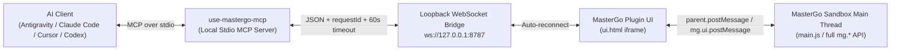

# use-mastergo-mcp

[](./.github/workflows/ci.yml)
[](./LICENSE)
[](https://nodejs.org/)
[](https://www.typescriptlang.org/)

English | [简体中文](./README.zh-CN.md)

**High-throughput, direct read/write MasterGo MCP server** inspired by Figma's `use_figma` paradigm.

Instead of exposing dozens of slow, fragile atomic tools (`create_rectangle`, `set_fill`, `create_text`, ...), `use-mastergo-mcp` gives AI agents **4 high-leverage tools** backed by a local `127.0.0.1` WebSocket bridge and a lightweight MasterGo desktop plugin—so an AI can build or edit an entire page in **1 MCP call**, batch-upload local images in milliseconds, and visually self-verify via exported PNG screenshots.

---

## Why `use-mastergo-mcp`?

| Dimension | Official `mastergo-magic-mcp` | Atomic Community MCPs | **`use-mastergo-mcp`** |
| :--- | :--- | :--- | :--- |
| **Canvas Write / Edit** | Read-only (design → code) | Supported | **Full `mg.*` Plugin API** |
| **Calls to Build 1 Page** | N/A | 50–200+ fragile tool calls | **1–3 high-throughput calls** |
| **Local Image Upload** | N/A | Often slow external URLs | **Direct disk → `mg.createImage()` batch** |
| **Visual Self-Verification** | Manual | Usually missing | **Built-in `screenshot_node` PNG loop** |
| **Cost & Limits** | Official API limits | Varies | **100% free, local, unlimited pages & calls** |
| **AI Knowledge Pack** | — | — | **Bundled [`skills/mastergo-use/SKILL.md`](./skills/mastergo-use/SKILL.md)** |

---

## Architecture



---

## 5-Minute Quick Start

### 1. Build the Repository

```bash
git clone https://github.com/nalin3166-collab/use-mastergo-mcp.git
cd use-mastergo-mcp
pnpm install
pnpm build
```

> Prefer `npx` once published to npm? Run `npx -y use-mastergo-mcp` directly for the MCP server, and download the pre-built plugin bundle from GitHub Releases.

### 2. Load the Bridge Plugin in MasterGo Desktop

1. Open any design file in the **MasterGo Desktop** client *(note: the web app does not support local development plugins)*.
2. Right-click on the canvas → **Plugins (插件) → Dev Plugins (开发插件) → Create / Add Plugin (创建 / 添加插件)** and select `packages/mg-plugin/dist/manifest.json`.
3. Launch **use-mastergo-mcp Bridge** and confirm the panel shows green **Connected :8787** and **Sandbox eval: OK**.

### 3. Configure Your AI Client

<details open>
<summary><strong>Antigravity</strong> (Global Plugin or <code>~/.gemini/config/mcp_config.json</code>)</summary>

```json
{
  "mcpServers": {
    "use-mastergo-mcp": {
      "command": "node",
      "args": ["/ABSOLUTE/PATH/TO/use-mastergo-mcp/packages/mcp-server/dist/index.js"],
      "env": {
        "MASTERGO_BRIDGE_PORT": "8787"
      }
    }
  }
}
```

Copy [`skills/mastergo-use/SKILL.md`](./skills/mastergo-use/SKILL.md) to `~/.gemini/config/skills/mastergo-use/SKILL.md` (or bundle both inside `~/.gemini/config/plugins/use-mastergo-mcp/`).
</details>

<details>
<summary><strong>Claude Code</strong></summary>

```bash
claude mcp add use-mastergo-mcp -- node /ABSOLUTE/PATH/TO/use-mastergo-mcp/packages/mcp-server/dist/index.js
# Or with npx once published:
claude mcp add use-mastergo-mcp -- npx -y use-mastergo-mcp
```
</details>

<details>
<summary><strong>Cursor</strong> (<code>.cursor/mcp.json</code>)</summary>

```json
{
  "mcpServers": {
    "use-mastergo-mcp": {
      "command": "npx",
      "args": ["-y", "use-mastergo-mcp"],
      "env": {
        "MASTERGO_BRIDGE_PORT": "8787"
      }
    }
  }
}
```
</details>

<details>
<summary><strong>Codex CLI</strong> (<code>~/.codex/config.toml</code>)</summary>

```toml
[mcp_servers.use-mastergo-mcp]
command = "npx"
args = ["-y", "use-mastergo-mcp"]

[mcp_servers.use-mastergo-mcp.env]
MASTERGO_BRIDGE_PORT = "8787"
```
</details>

---

## MCP Tools Reference

| Tool | Parameters | Description |
| :--- | :--- | :--- |
| **`mastergo_status`** | *(none)* | Checks loopback WebSocket bridge connectivity, plugin capabilities (`dynamicEval`), active file name, full page list, and current selection summary. |
| **`use_mastergo`** | `code: string`, `description: string`, `timeoutMs?: number` | Runs an async JS function body inside the MasterGo plugin main thread with full `mg.*` access, captures `console.*` logs, commits a single undo step, and returns structured JSON (or formatted error + stack trace). |
| **`upload_local_images`** | `paths: string[]`, `maxDimension?: number` | Reads local PNG/JPG/WebP/GIF files from disk, optionally downscales oversized images (default `2048px` max edge via `sharp`), uploads them via `mg.createImage()`, and returns `{ images: { [path]: imageRef } }`. |
| **`screenshot_node`** | `nodeId: string`, `scale?: number`, `savePath?: string`, `returnImage?: boolean` | Exports any MasterGo node/artboard via `node.exportAsync({ format: 'PNG', ... })`, saves it locally, and optionally returns the PNG inline for automated visual inspection. |

---

## Bundled Agent Skill (`skills/mastergo-use/SKILL.md`)

MasterGo's Plugin API differs subtly but critically from Figma's (e.g. `mg.document.currentPage`, `flexMode` instead of `layoutMode`, `SolidPaint.color.a` + `isVisible`, `TextNode.setRangeFontName`/`setRangeFontSize`, async `mg.createImage()` returning `image.href` for `ImagePaint.imageRef`, async `mg.createNodeFromSvgAsync()`).

Loading [`skills/mastergo-use/SKILL.md`](./skills/mastergo-use/SKILL.md) equips your AI assistant with the exact verified `@mastergo/plugin-typings` API and copy-paste helpers so complex multi-section scripts work on the first try.

---

## Security & Privacy

- **Loopback-Only Binding**: The WebSocket bridge binds strictly to **`127.0.0.1`** and never listens on `0.0.0.0` or external network interfaces.
- **Zero Cloud Relay**: All scripts, local images, and exported PNGs stay 100% on your local machine.
- **Explicit User Control**: Canvas execution only runs while you have explicitly opened the bridge plugin inside your MasterGo desktop session. Every `use_mastergo` run is wrapped in `mg.commitUndo()` for single-step `Ctrl/Cmd+Z` rollback.

---

## Development

```bash
pnpm install
pnpm build       # Build protocol, mcp-server (dist/index.js), and mg-plugin (dist/)
pnpm typecheck   # Strict TypeScript check across all packages
pnpm test        # Run Vitest unit & end-to-end MCP tool tests
```

See [CONTRIBUTING.md](./CONTRIBUTING.md) for guidelines and [CHANGELOG.md](./CHANGELOG.md) for release notes.

## License

[MIT](./LICENSE)
