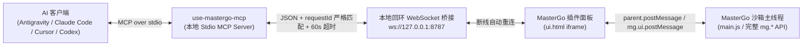

# use-mastergo-mcp

[](./.github/workflows/ci.yml)
[](./LICENSE)
[](https://nodejs.org/)
[](https://www.typescriptlang.org/)

[English](./README.md) | 简体中文

**高吞吐、支持直接写入与修改画布的 MasterGo MCP Server**，借鉴官方 Figma `use_figma` 范式打造。

不同于把 API 拆成几十个细碎原子工具的传统方案，`use-mastergo-mcp` 采用 **「本地 MCP Server + 本地 `127.0.0.1` WebSocket 桥接 + MasterGo 桌面端插件」** 架构，仅用 **4 个高杠杆核心工具** 即可实现 **1 次 MCP 调用批量生成/修改整页设计稿、本地图片毫秒级直传、导出画板 PNG 自动视觉自检**——100% 免费、本地运行、不限页面数与调用次数。

---

## 核心亮点对比

| 对比维度 | 官方 `mastergo-magic-mcp` | 细碎原子工具社区 MCP | **`use-mastergo-mcp`** |
| :--- | :--- | :--- | :--- |
| **直接写入 / 修改画布** | 仅只读（设计稿转代码） | 支持 | **完整 `mg.*` Plugin API 读写** |
| **绘制 1 个复杂页面的调用次数** | 不支持 | 50–200+ 次（极易断链） | **1–3 次高吞吐批量完成** |
| **本地图片上画布** | 不支持 | 常依赖外网图床易超时 | **本机读盘 + 自动缩放 + 批量 `mg.createImage()`** |
| **视觉闭环自检** | 人工肉眼查 | 多数缺失 | **内置 `screenshot_node` 导出 PNG 自动验收** |
| **费用与限制** | 官方接口限制 | 视实现而定 | **100% 免费、纯本地、不限页数与次数** |
| **AI 精准语法包** | — | — | **内置经 `.d.ts` 核实的 [`skills/mastergo-use/SKILL.md`](./skills/mastergo-use/SKILL.md)** |

---

## 系统架构



---

## 5 分钟快速上手

### 1. 克隆并构建项目

```bash
git clone https://github.com/nalin3166-collab/use-mastergo-mcp.git
cd use-mastergo-mcp
pnpm install
pnpm build
```

> 发布到 npm 后也可直接用 `npx -y use-mastergo-mcp` 启动 MCP Server，并从 GitHub Releases 下载预构建的插件压缩包。

### 2. 在 MasterGo 桌面客户端加载本地插件

1. 打开 **MasterGo 桌面客户端**（注意：网页版不支持本地开发插件），进入任意设计文件画布。
2. 在画布空白处 **右键 →「插件」→「开发插件」→「创建 / 添加插件」**，选择本项目的构建清单文件：`packages/mg-plugin/dist/manifest.json`。
3. 在 **「管理插件」→「开发与发布」** 或右键菜单运行 **use-mastergo-mcp Bridge**。确认面板显示绿色 **Connected :8787** 与 **Sandbox eval: OK** 即可开始使用。

### 3. 配置 AI 客户端

<details open>
<summary><strong>Antigravity</strong>（推荐插件化安装，或配置 <code>~/.gemini/config/mcp_config.json</code>）</summary>

```json
{
  "mcpServers": {
    "use-mastergo-mcp": {
      "command": "node",
      "args": ["/你的绝对路径/use-mastergo-mcp/packages/mcp-server/dist/index.js"],
      "env": {
        "MASTERGO_BRIDGE_PORT": "8787"
      }
    }
  }
}
```

将 [`skills/mastergo-use/SKILL.md`](./skills/mastergo-use/SKILL.md) 复制到 `~/.gemini/config/skills/mastergo-use/SKILL.md`（或打包到 `~/.gemini/config/plugins/use-mastergo-mcp/`）。
</details>

<details>
<summary><strong>Claude Code</strong></summary>

```bash
claude mcp add use-mastergo-mcp -- node /你的绝对路径/use-mastergo-mcp/packages/mcp-server/dist/index.js
# 或发布后通过 npx 启动：
claude mcp add use-mastergo-mcp -- npx -y use-mastergo-mcp
```
</details>

<details>
<summary><strong>Cursor</strong>（<code>.cursor/mcp.json</code>）</summary>

```json
{
  "mcpServers": {
    "use-mastergo-mcp": {
      "command": "npx",
      "args": ["-y", "use-mastergo-mcp"],
      "env": {
        "MASTERGO_BRIDGE_PORT": "8787"
      }
    }
  }
}
```
</details>

<details>
<summary><strong>Codex CLI</strong>（<code>~/.codex/config.toml</code>）</summary>

```toml
[mcp_servers.use-mastergo-mcp]
command = "npx"
args = ["-y", "use-mastergo-mcp"]

[mcp_servers.use-mastergo-mcp.env]
MASTERGO_BRIDGE_PORT = "8787"
```
</details>

---

## 4 个核心 MCP 工具说明

| 工具名 | 参数 | 功能说明 |
| :--- | :--- | :--- |
| **`mastergo_status`** | *（无参数）* | 检查本地 WebSocket 是否已连接 MasterGo 插件，返回连接状态、插件能力自检（`dynamicEval`）、当前文件名、全部 Page 列表及选中节点摘要。 |
| **`use_mastergo`** | `code: string`, `description: string`, `timeoutMs?: number` | 将支持 `async/await` 与 `return` 的 JS 脚本发往 MasterGo 插件主线程执行，自动捕获 `console.*` 日志、返回结构化 JSON（或带堆栈的清晰报错），并在执行完毕自动 `mg.commitUndo()` 以便单步撤销。 |
| **`upload_local_images`** | `paths: string[]`, `maxDimension?: number` | 直接读取本机 PNG/JPG/WebP/GIF 图片，按最大边（默认 `2048px`，基于 `sharp`）自动缩放防爆内存，批量调用 `mg.createImage()` 返回 `{ images: { [path]: imageRef } }` 映射表。 |
| **`screenshot_node`** | `nodeId: string`, `scale?: number`, `savePath?: string`, `returnImage?: boolean` | 调用 MasterGo 原生 `node.exportAsync({ format: 'PNG', ... })` 导出任意节点或画板并落盘，同时按需内联返回图像供 AI 视觉自检文字裁切、白底、重叠等瑕疵。 |

---

## 配套 Agent Skill（`skills/mastergo-use/SKILL.md`）

MasterGo 的 Plugin API 与 Figma 存在多处高频踩坑差异（例如 `mg.document.currentPage`、`flexMode` 替代 `layoutMode`、纯色透明度写在 `color.a` 且可见性为 `isVisible`、`TextNode` 必须用 `setRangeFontName`/`setRangeFontSize`、异步 `mg.createImage()` 返回 `image.href` 赋给 `imageRef`、异步 `mg.createNodeFromSvgAsync()` 等）。

加载配套的 [`skills/mastergo-use/SKILL.md`](./skills/mastergo-use/SKILL.md) 后，AI 每次编写 `use_mastergo` 脚本都会遵循 `@mastergo/plugin-typings` 实测规范，大幅提高一次跑通率。

---

## 安全与隐私声明

- **严格仅监听本地回环**：WebSocket 服务硬编码仅绑定 **`127.0.0.1`**，绝不对外网或局域网（`0.0.0.0`）暴露端口。
- **零云端中转**：所有脚本、本地素材图片与导出截图均只在你的本机内存中流转。
- **完全可控与一键撤销**：仅当你主动在 MasterGo 桌面端打开桥接插件时才会接收指令；每次 `use_mastergo` 变更自动合并为单次历史记录，随时可 `Ctrl/Cmd+Z` 一键撤销。

---

## 本地开发与测试

```bash
pnpm install
pnpm build       # 构建 protocol、mcp-server 与 mg-plugin
pnpm typecheck   # 全工作区严格 TypeScript 类型检查
pnpm test        # 运行 Vitest 单元测试与 4 工具端到端测试
```

欢迎阅读 [CONTRIBUTING.md](./CONTRIBUTING.md) 参与共建，版本记录见 [CHANGELOG.md](./CHANGELOG.md)。

## 开源协议

本项目基于 [MIT](./LICENSE) 协议开源。
